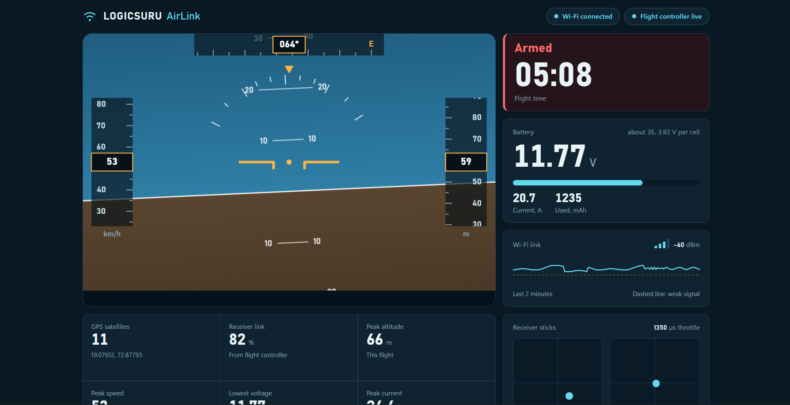

# LOGICSURU AirLink

A live flight dashboard for a 5-inch FPV quad. An ESP32-C3 SuperMini sits on the drone, reads telemetry from the Betaflight flight controller over UART, and serves a web page from its own Wi-Fi network. Connect a laptop or phone to the drone, open the page, and watch the flight data update in real time.

No ground station, no extra radio, no app to install.



## How it works

The ESP32-C3 talks to the flight controller using MSP (MultiWii Serial Protocol), the same protocol Betaflight Configurator uses. It polls the controller for attitude and RC data, then pushes the values to the browser. The ESP32 runs as a Wi-Fi access point and web server, so the dashboard works anywhere without a router or internet connection.

```
Flight controller  --UART (MSP)-->  ESP32-C3  --Wi-Fi AP-->  Browser dashboard
```

The page shows:

- artificial horizon (pitch and roll)
- stick positions for throttle, yaw, pitch and roll
- armed / disarmed state

If the drone flies out of Wi-Fi range, the page shows a disconnected state and reconnects on its own when the signal returns.

## Hardware

| Part | Used |
|------|------|
| Microcontroller | ESP32-C3 SuperMini |
| Flight controller | BotWing F405 running Betaflight |
| Receiver | FlySky |
| Frame | 5-inch freestyle quad |

### Wiring

The ESP32-C3 connects to a spare UART on the flight controller (UART6 on this board).

| ESP32-C3 | Flight controller |
|----------|-------------------|
| GPIO20 (RX) | TX6 |
| GPIO21 (TX) | RX6 |
| GND | GND |

Cross TX and RX as shown. Power the ESP32-C3 from a regulated 5V pad on the flight controller, not directly from the battery.

### Betaflight setup

In the Ports tab, enable **MSP** on the UART you wired to (UART6 here) and save. Make sure the baud rate matches the one set in the sketch.

## Flashing

1. Install the ESP32 board package in the Arduino IDE.
2. Select **ESP32C3 Dev Module** as the board.
3. Enable **USB CDC On Boot** (needed for serial output on the SuperMini).
4. Open `AirLink.ino`, check the Wi-Fi name and password near the top, and upload.

The whole project is a single sketch. Any libraries it needs are listed in the `#include` lines at the top of `AirLink.ino`.

## Using it

1. Power the drone.
2. Join the Wi-Fi network the ESP32-C3 creates.
3. Open `http://192.168.4.1` in a browser.
4. Arm the quad and the dashboard starts updating.

## Notes from testing

I tested this against the real flight controller rather than only in simulation. Early on the horizon showed pitch inverted, and the throttle and yaw axes were swapped on the stick display. Both are corrected in the current version.

## Roadmap

- Additional telemetry fields (battery voltage, flight modes)
- Flight logging to review a session afterwards

## Author

Built by Suraj Maru as part of the LOGICSURU project series. Build videos are on [YouTube](https://youtube.com/@logicsuru), and more of my work is at [surajthedev.com](https://surajthedev.com).
